# 💻 Portfólio Profissional — Maria Eduarda Brito 👩‍💻

Website de portfólio profissional bilíngue (PT/EN), responsivo e acessível, que apresenta trajetória, projetos, experiências e formas de contato. Desenvolvido em **React + Vite** como Trabalho Prático 1 (Desenvolvimento e Integração de Aplicações Web — PUC Minas).

---

## 1. 🚧 Status do Projeto


---

## 2. 📚 Índice

1. [Status do Projeto](#1--status-do-projeto)
2. [Índice](#2--índice)
3. [Links Úteis](#3--links-úteis)
4. [Sobre o Projeto](#4--sobre-o-projeto)
5. [Funcionalidades Principais](#5--funcionalidades-principais)
6. [Tecnologias Utilizadas](#6--tecnologias-utilizadas)
7. [Arquitetura](#7--arquitetura)
8. [Instalação e Execução](#8--instalação-e-execução)
9. [Deploy](#9--deploy)
10. [Estrutura de Pastas](#10--estrutura-de-pastas)
11. [Demonstração](#11--demonstração)
12. [Testes](#12--testes)
13. [Documentações Utilizadas](#13--documentações-utilizadas)
14. [Autores](#14--autores)
15. [Contribuição](#15--contribuição)
16. [Agradecimentos](#16--agradecimentos)
17. [Licença](#17--licença)

---

## 3. 🔗 Links Úteis

- 🌐 **Site publicado:** https://maria-brito15.github.io/portfolio-diaw/
- 📦 **Repositório:** https://github.com/maria-brito15/portfolio-diaw
- 🎨 **Wireframes (média fidelidade):** [`/docs/wireframes`](docs/wireframes) — importáveis no Figma (ver [Demonstração](#11--demonstração))

---

## 4. 📝 Sobre o Projeto

Portfólio profissional que reúne, em quatro seções acessadas por um menu de navegação, a apresentação, os projetos, as experiências e os canais de contato de Maria Eduarda de Paula Brito, estudante de Engenharia de Software na PUC Minas com foco em back-end, arquitetura de software e Specification-Driven Development (SDD).

A identidade visual é tipográfica e sem enfeites: cada seção é uma "folha" de cor sólida (verde-acinzentado, azul cobalto, amarelo e azul-marinho), com títulos em Familjen Grotesk e texto em Source Serif 4. Não há cartões, sombras nem gradientes; o destaque vem do tamanho do texto e da cor. A cor da página muda quando o visitante navega entre as seções.

### Dois portfólios, dois repositórios

Este trabalho tem duas versões do portfólio:

| Repositório | Descrição |
| --- | --- |
| [`portfolio-diaw`](https://github.com/maria-brito15/portfolio-diaw) | **Este projeto** — versão enxuta e finalizada, entregue no Trabalho Prático 1. |
| [`portfolio-react-vite`](https://github.com/maria-brito15/portfolio-react-vite) | Versão mais complexa (terminal interativo, desenvolvida com SDD), que não foi finalizada a tempo da entrega. |

---

## 5. ✨ Funcionalidades Principais

- 🧭 **Menu de navegação** com 4 seções: Sobre Mim, Projetos, Experiências e Contato (menu hambúrguer no mobile).
- 🌐 **Bilíngue PT/EN:** alternância de idioma em todo o site; a página “Sobre Mim” traz também a versão no outro idioma.
- 🕒 **Timeline de projetos** em ordem cronológica (do mais antigo ao mais recente), com nome, descrição, tecnologias e link do GitHub.
- 💼 **Experiências** com filtro por tipo (ensino, extensão, evento técnico, curso, reconhecimento).
- 📬 **Contato** com ícones clicáveis (e-mail, LinkedIn, GitHub, WhatsApp) e formulário com validação e envio por e-mail via EmailJS.
- 🎨 **Cada seção com sua cor**, com transição suave ao navegar (respeita `prefers-reduced-motion`).
- ♿ **Acessibilidade:** link “pular para o conteúdo”, foco visível, rótulos ARIA, mensagens de erro anunciadas, `prefers-reduced-motion`.
- 📱 **Responsivo** (mobile-first, testado de 360 px a desktop).

---

## 6. 🛠 Tecnologias Utilizadas

### Front-end
- **React 19** + **TypeScript** (modo estrito)
- **Vite** (build e servidor de desenvolvimento)
- **React Router** (`HashRouter`, sem necessidade de regras de rewrite no host)
- **React Hook Form** (formulário e validações)
- **EmailJS** (envio de e-mail diretamente do front-end)
- **CSS puro** com variáveis de cor por seção
- Fontes: **Familjen Grotesk** e **Source Serif 4** (via `@fontsource`, auto-hospedadas)

### Infraestrutura e DevOps
- **GitHub Pages** (hospedagem gratuita)
- **GitHub Actions** (CI: type-check, lint e build)

### Dependências

| Pacote | Uso |
| --- | --- |
| `react`, `react-dom` | Interface |
| `react-router-dom` | Navegação entre seções |
| `react-hook-form` | Formulário de contato |
| `@emailjs/browser` | Envio de e-mail |
| `@fontsource-variable/familjen-grotesk`, `@fontsource-variable/source-serif-4` | Fontes |
| `vite`, `@vitejs/plugin-react`, `typescript`, `oxlint` | Build, tipagem e lint |

---

## 7. 🏗 Arquitetura

SPA estática, sem back-end próprio. O conteúdo vive em módulos TypeScript tipados (`src/data`), separados da apresentação, e cada texto é um objeto `{ pt, en }`, o que mantém a internacionalização simples e verificada pelo compilador.

- **Camada de dados:** `src/data/*` (perfil, projetos, experiências, textos da interface).
- **Estado global:** um contexto leve, `lang` (idioma), persistido em `localStorage`. A cor de cada seção vem de um atributo `data-page` no `<html>`.
- **Camada de UI:** `Layout` (cabeçalho, rodapé, foco de página) + páginas em `src/pages` + componentes reutilizáveis.
- **Formulário:** com as variáveis do EmailJS configuradas, envia direto do navegador; sem elas, faz _fallback_ para `mailto:` com a mensagem preenchida — o formulário nunca fica inoperante.
- **Decisão de roteamento:** `HashRouter` evita 404 ao recarregar rotas em hosts estáticos (GitHub Pages) e dispensa configuração extra no GitHub Pages.

**Trade-off:** o EmailJS expõe a _public key_ no bundle (por desenho do serviço). A mitigação é o limite de cota e a restrição de domínio configurados no painel do EmailJS, além de um campo _honeypot_ contra bots.

---

## 8. 🔧 Instalação e Execução

### Pré-requisitos
- Node.js 20+ (LTS) e npm

### Variáveis de Ambiente

Copie `.env.example` para `.env.local`:

```bash
cp .env.example .env.local
```

| Variável | Descrição |
| --- | --- |
| `VITE_EMAILJS_SERVICE_ID` | ID do serviço no EmailJS |
| `VITE_EMAILJS_TEMPLATE_ID` | ID do template (variáveis: `from_name`, `reply_to`, `message`) |
| `VITE_EMAILJS_PUBLIC_KEY` | Public key do EmailJS |
| `VITE_WHATSAPP_NUMBER` | Número com DDI+DDD, só dígitos (ex.: `5531999999999`). Se vazio, o ícone do WhatsApp não é exibido |

> Sem as variáveis do EmailJS, o formulário abre o app de e-mail do usuário (`mailto:`).

### Instalação de dependências

```bash
git clone https://github.com/maria-brito15/portfolio-diaw.git
cd portfolio-diaw
npm install
```

### Como executar

```bash
npm run dev       # servidor de desenvolvimento em http://localhost:5173
npm run build     # type-check + build de produção em /dist
npm run preview   # serve o build localmente
npm run lint      # análise estática
```

---

## 9. 🚀 Deploy

### GitHub Pages (GitHub Actions)
1. Faça push para a branch `main` do repositório `portfolio-diaw`.
2. Em **Settings → Pages**, selecione **Source: GitHub Actions**.
3. Em **Settings → Secrets and variables → Actions**, cadastre os _secrets_ `VITE_EMAILJS_SERVICE_ID`, `VITE_EMAILJS_TEMPLATE_ID`, `VITE_EMAILJS_PUBLIC_KEY` e `VITE_WHATSAPP_NUMBER`.
4. O workflow `.github/workflows/deploy.yml` faz o build e publica em `https://maria-brito15.github.io/portfolio-diaw/` a cada push na `main`.

O `vite.config.ts` usa `base: './'` e o roteamento é por hash (`HashRouter`), portanto o site funciona no subcaminho do Pages sem regras de rewrite.

---

## 10. 📂 Estrutura de Pastas

```
.
├── .github/workflows/           # ci.yml (lint + build) e deploy.yml (GitHub Pages)
├── docs/
│   ├── wireframes/              # wireframes de média fidelidade (SVG → Figma)
│   └── screens/                 # capturas de tela (desktop e mobile)
├── public/
│   └── favicon.svg
├── src/
│   ├── components/              # Layout, ContactForm, SocialLinks, Icons, PageHeader
│   ├── context/                 # lang.tsx (PT/EN)
│   ├── data/                    # profile, projects, experiences, ui (conteúdo tipado)
│   ├── pages/                   # About, Projects, Experience, Contact, NotFound
│   ├── styles/global.css        # design tokens, layout e responsividade
│   ├── App.tsx                  # rotas
│   └── main.tsx                 # entrada
├── .env.example
├── index.html
├── package.json
└── vite.config.ts
```

---

## 11. 🎥 Demonstração

### Wireframes (média fidelidade)

| Sobre Mim | Projetos |
| --- | --- |
| 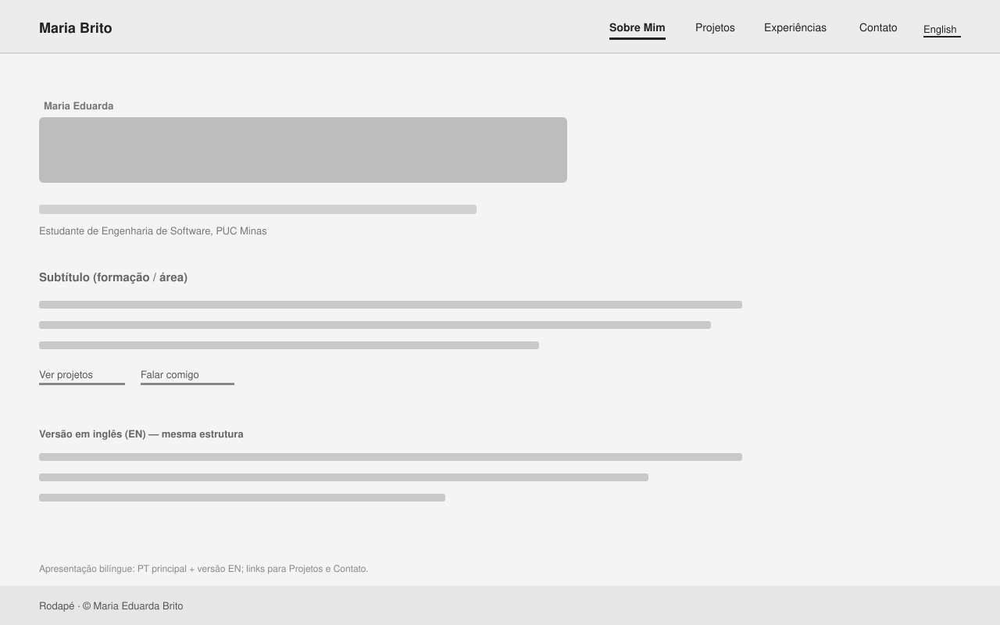 | 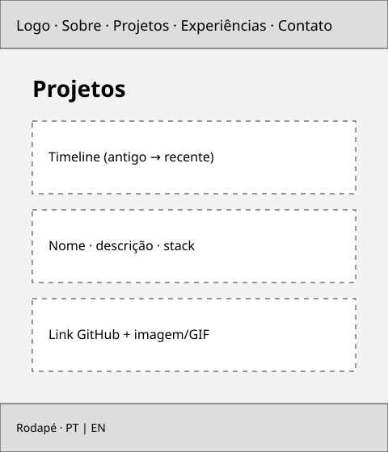 |
| **Experiências** | **Contato** |
| 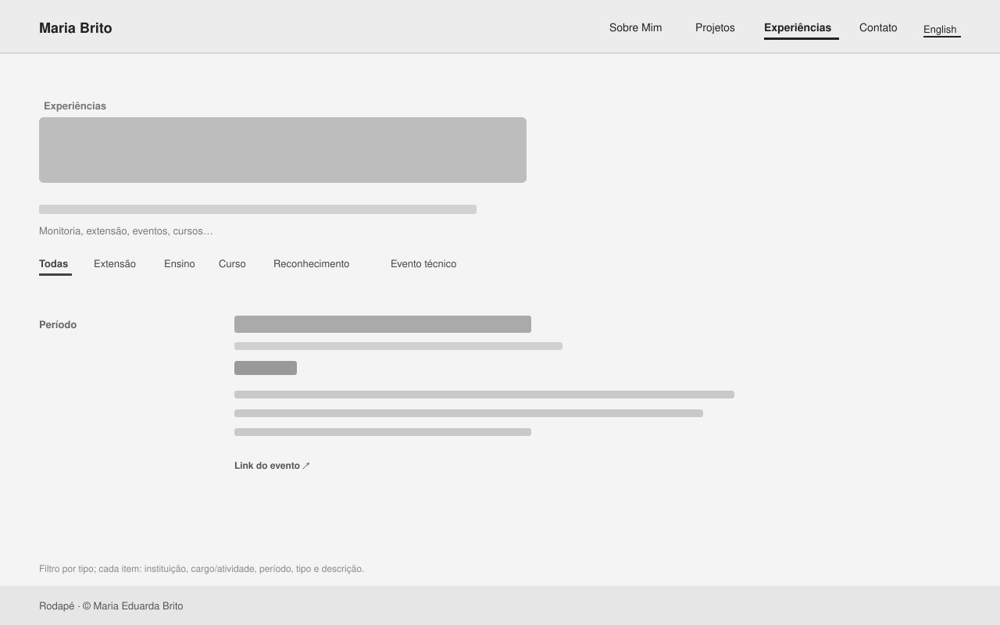 | 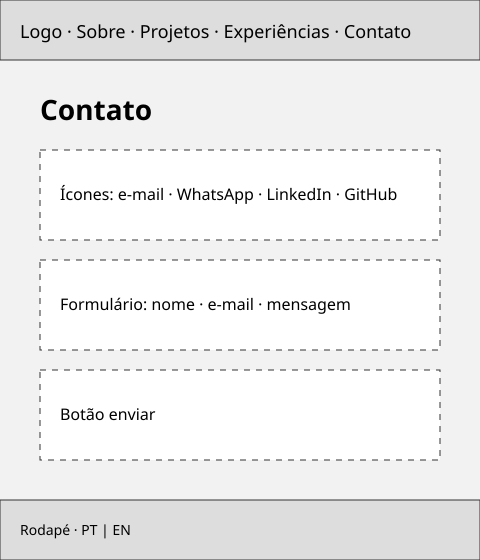 |

Para usar no Figma: arraste os arquivos `.svg` de `docs/wireframes` para um frame (cada elemento é editável como vetor).

### Telas do site

| Sobre Mim | Projetos |
| --- | --- |
| 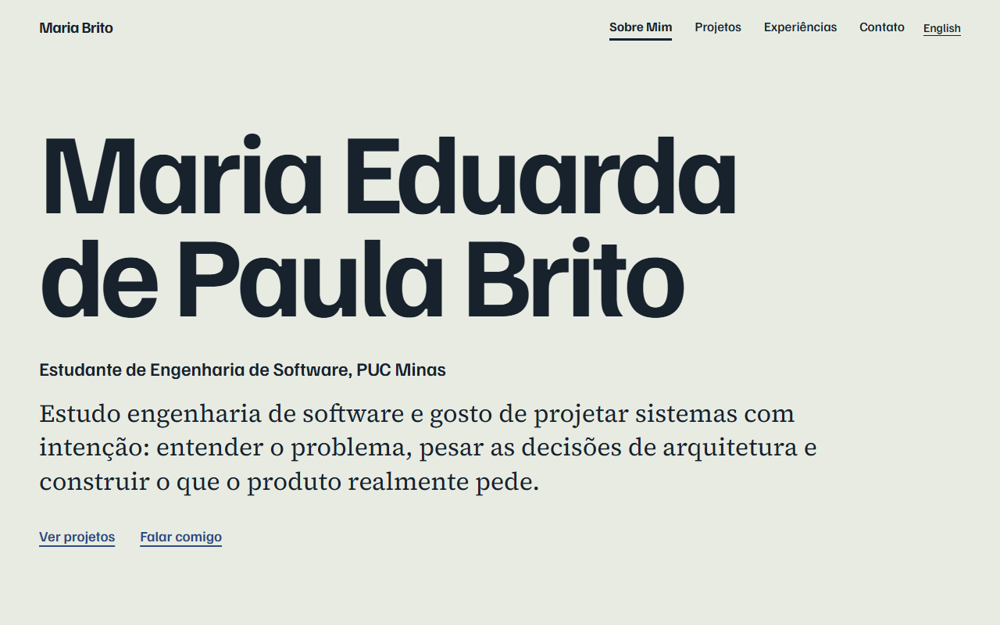 | 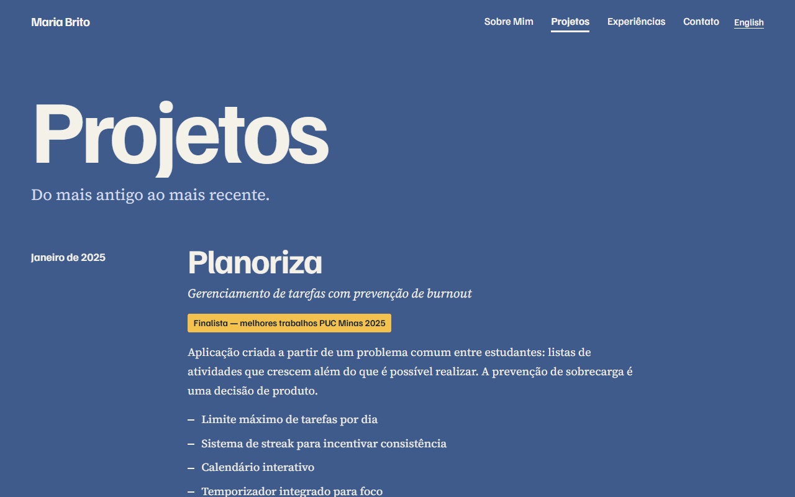 |
| **Experiências** | **Contato** |
| 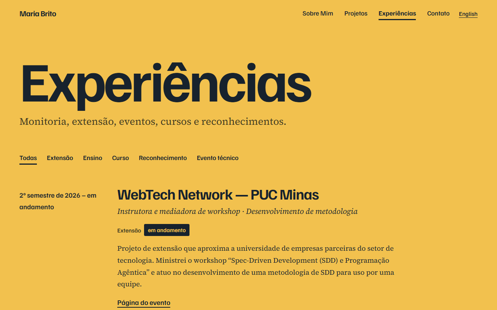 | 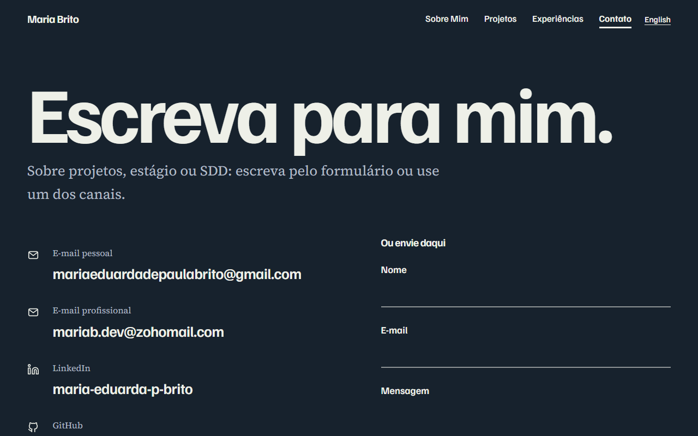 |

Versão mobile (390 px):

| Sobre Mim | Projetos | Experiências | Contato |
| --- | --- | --- | --- |
| 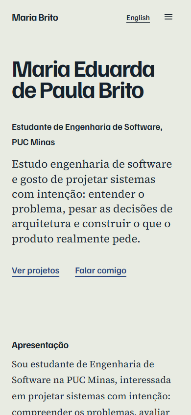 | 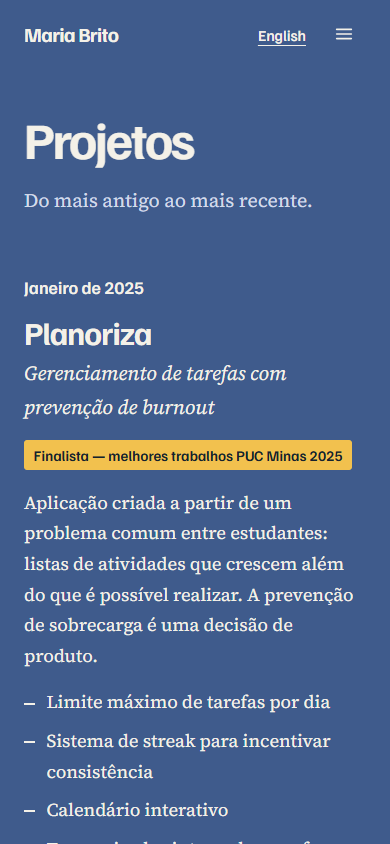 | 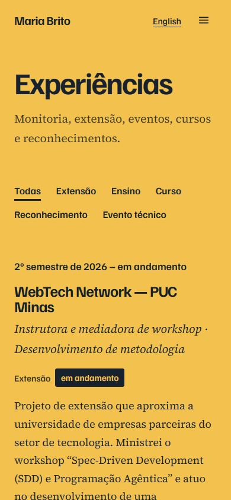 | 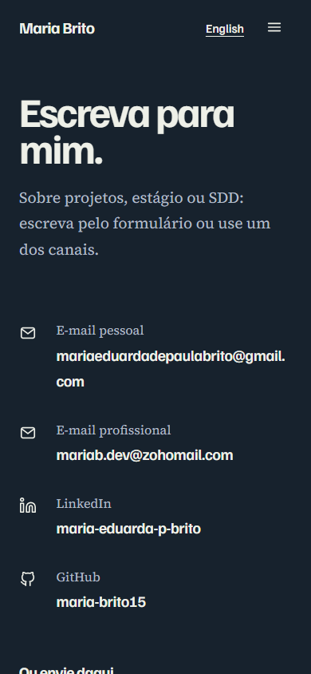 |

---

## 12. 🧪 Testes

Validação automatizada no CI: `tsc -b` (tipagem estrita), `oxlint` e `vite build`. Os fluxos do formulário (validações e mensagens) foram verificados manualmente.

---

## 13. 🔗 Documentações Utilizadas

- [React](https://react.dev) · [Vite](https://vite.dev) · [React Router](https://reactrouter.com)
- [React Hook Form](https://react-hook-form.com) · [EmailJS](https://www.emailjs.com/docs/)
- [WCAG 2.2](https://www.w3.org/TR/WCAG22/) · [GitHub Pages Docs](https://docs.github.com/pages)

---

## 14. 👥 Autores

| Nome | GitHub | LinkedIn | E-mail |
| --- | --- | --- | --- |
| Maria Eduarda de Paula Brito | [@maria-brito15](https://github.com/maria-brito15) | [maria-eduarda-p-brito](https://www.linkedin.com/in/maria-eduarda-p-brito-a18064358/) | mariaeduardadepaulabrito@gmail.com |

---

## 15. 🤝 Contribuição

1. Faça um fork do projeto
2. Crie uma branch: `git checkout -b feat/minha-melhoria`
3. Commit seguindo [Conventional Commits](https://www.conventionalcommits.org/): `git commit -m "feat: descrição"`
4. Push: `git push origin feat/minha-melhoria`
5. Abra um Pull Request

---

## 16. 🙏 Agradecimentos

- PUC Minas e ao professor da disciplina de Desenvolvimento e Integração de Aplicações Web.
- WebTech Network.

---

## 17. 📄 Licença

Distribuído sob a licença MIT.
